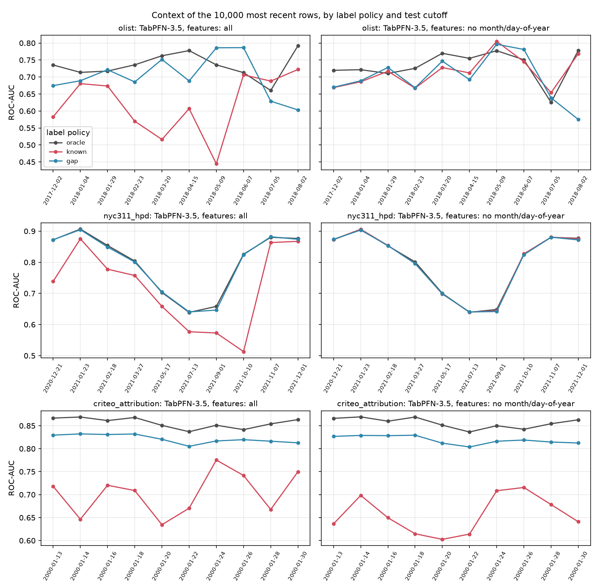
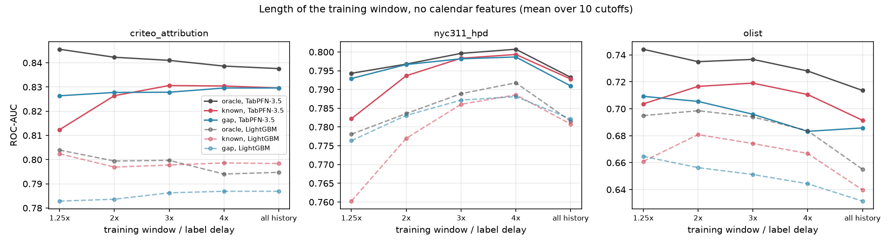

# tfm-supply-chain-bench

Do tabular foundation models (TFMs) beat tuned gradient-boosted trees on supply chain
prediction when the split respects time? This repository benchmarks TabPFN-3.5 and
TabICLv2 against XGBoost, LightGBM and CatBoost on public supply chain data, under random,
grouped and temporal splits, and reports where each model wins and where it falls short.
TabPFN-2.5 is kept as a reference column, to show how much of the gap the newer
checkpoint closes on the same tasks.

> Status: the main model comparison has not been run under the full protocol yet. The first
> result is an exploratory study of label delay on the `exp/label-delay` branch, see
> [Results](#results).

## Research questions

1. **Accuracy:** on regression and classification tasks, do TFMs beat tuned GBDTs?
2. **Split effect:** how much does performance change from a random split to a temporal
   split (train on the past, predict the future)? Most tabular benchmarks, including
   TabArena v0.1, cover IID data only. The change is reported in two steps, because a
   random split of order lines also leaks orders across train and test:
   random → grouped (whole orders kept together) is the group-leakage effect, and
   grouped → temporal is the effect of time.
3. **Failure regions:** when do TFMs lose: training size, high-cardinality categoricals,
   distribution shift over time?
4. **Cost:** what does each model cost in fit and prediction time for the accuracy it gets?

## Data

```bash
bash scripts/download_data.sh            # DataCo, Olist and Criteo into data/raw/ (not committed)
python scripts/make_synthetic.py         # synthetic control
```

| Dataset (`--dataset`) | Rows | Regression task | Classification task | Role |
| --- | --- | --- | --- | --- |
| Olist Brazilian e-commerce (`olist`) | 96,470 delivered orders, 2016-09 to 2018-08 | `delivery_days` | `late_delivery` | main real dataset |
| DataCo Smart Supply Chain (`dataco`) | 180,519 order lines, 2015-01 to 2018-01 | `shipping_days` | `late_delivery` | caution case, see below |
| NYC 311 housing requests (`nyc311_hpd`) | 98,305 requests to HPD, 2020 to 2021 (a 10% sample) | none | `slow_14d` | second dataset for the label-delay study, not supply chain |
| Criteo attribution (`criteo_attribution`) | 118,875 ad clicks over 31 days (a 2% sample of users) | none | `converted_7d` | third dataset for the label-delay study, not supply chain |
| Synthetic order lines (`synth`) | set by `--n-orders` | `shipping_days` | `late_delivery` | control with known truth |
| USAID shipment pricing, SCMS (`usaid`) | not downloaded | `freight_cost` | `late_delivery` | on hold: the official host no longer resolves |

- **Olist.** `scripts/prepare_olist.py` joins orders, items, products, sellers, customers,
  payments and zip-code locations into one row per delivered order. The prediction is
  made at purchase: features are the basket, seller, destination, distance, price,
  freight, payment and the promised delivery time. The late rate moves from about 3% in
  2017 to 13% in early 2018 and back to 4%, so the temporal split has real drift to
  measure. Source: the original Kaggle release (`olistbr/brazilian-ecommerce`,
  CC BY-NC-SA 4.0, non-commercial), downloaded from a copy on
  [Hugging Face](https://huggingface.co/datasets/bulutttt/olist-raw-data).
  Confirm the license on the Kaggle page before publishing results.
- **DataCo.** [Mendeley Data, version 5](https://data.mendeley.com/datasets/8gx2fvg2k6/5)
  (DOI 10.17632/8gx2fvg2k6.5, listed as CC BY 4.0). The file behaves like generated
  data: within Standard and Second Class shipping, the real shipping days are spread
  evenly over 2 to 6 (20% each), so lateness is the shipping mode plus noise and
  models are expected to tie. From October 2017 only 13 of the 100 earlier products
  remain. It is kept to show what a benchmark on such data looks like, not to rank models.
- **NYC 311.** `scripts/prepare_nyc311.py` downloads a sample of the service requests of one
  agency from [NYC Open Data](https://data.cityofnewyork.us/d/erm2-nwe9) (requests whose
  key ends in 7). The task `slow_14d` asks, when a request is filed, whether it will still
  be open 14 days later. The 14-day threshold is set by this repository (the official due
  date is filled for 0.4% of rows), so it is a constructed task. It is here because a fast
  request is labelled when it closes and a slow one only after 14 days, the same label
  mechanism as on Olist.
- **Criteo attribution.** `scripts/prepare_criteo.py` keeps the clicked impressions of the
  [Criteo Attribution Modeling for Bidding Dataset](https://huggingface.co/datasets/criteo/criteo-attribution-dataset)
  (CC BY-NC-SA 4.0, non-commercial). The task `converted_7d` asks, at the click, whether a
  conversion follows within 7 days. Here the positive label arrives first (at the
  conversion) and the negative one after 7 days, the opposite direction to Olist. The
  timestamps are relative, so the dates sit on an arbitrary origin, and the 7-day window is
  set by this repository.
- **Synthetic.** A control with a known generating process, not evidence about real
  supply chains: `--drift 0` gives a stationary world where the grouped and temporal
  splits should agree, and the printed oracle AUC is the ceiling any model can approach.
- **Group columns** for the grouped split: customer for Olist (3% of orders are repeat
  customers), `Order Id` for DataCo, order for the synthetic data.
- **Label delay.** A training order placed just before a cutoff may only be delivered
  after it, so its label would not be known yet in practice. On Olist an on-time label
  arrives at delivery and a late label when the promised date passes, so the recent orders
  with a known label are mostly the on-time ones. The default temporal split ignores this
  (`--label-policy oracle`). `--label-policy known` trains only on labels that have arrived
  by the cutoff, and `--label-policy gap` also leaves out the last `--label-gap-days`
  (default 30) before the cutoff. The label time of a task is set by `label_time_cols` in
  `configs/datasets.yaml`.

**Leakage control.** Every task lists `leakage_cols`: columns only known after the
prediction time (actual ship date, delivery status, actual freight). They are always
dropped, except in the leakage-injection ablation, which adds them back on purpose to
show how much a leak inflates scores.

## Setup

```bash
python -m venv .venv && source .venv/bin/activate
pip install -e ".[dev]"      # baselines + GBDTs + tests
pip install -e ".[tfm]"      # tabpfn 10.0.0 and tabicl 2.2.0, pinned (a GPU is strongly recommended)
pytest -q
```

| `--models` name | Model | Checkpoint | Weights license |
| --- | --- | --- | --- |
| `tabpfn` | TabPFN-3.5 (main) | `tabpfn-v3.5-20260909`, pinned in `models.py` | [TabPFN-3.5 license](https://huggingface.co/Prior-Labs/tabpfn_3_5/blob/main/LICENSE), non-commercial |
| `tabpfn-2.5` | TabPFN-2.5 (reference) | pinned in `models.py` | its own non-commercial license, see the [Prior Labs models page](https://docs.priorlabs.ai/models#tabpfn-model-license) |
| `tabicl` | TabICLv2 | `tabicl-classifier-v2-20260212`, the default of tabicl 2.2.0 | see the [TabICL model page](https://huggingface.co/jingang/TabICL) |

The TabPFN weights are licensed separately from the `tabpfn` package (Apache 2.0), and
each checkpoint has its own license document, so 3.5 and 2.5 are accepted separately. The
first run opens a browser to accept the license; on a headless machine set `TABPFN_TOKEN`.

TabPFN-3.5 accepts up to 1,000,000 training rows, and TabPFN-2.5 is recommended up to
50,000. The commands below still cap training at 50,000 rows so that both checkpoints see
the same data; how far TabPFN-3.5 goes without the cap on the available GPU has not been
measured yet.

## Running

```bash
# Main comparison, temporal split, 3 rolling-origin cutoffs x 5 seeds
tfmbench --dataset olist --task late_delivery --split temporal --n-folds 3 \
  --models linear xgboost lightgbm catboost tabpfn tabpfn-2.5 tabicl --max-train-rows 50000

# Same, grouped and random splits (to measure the split effect in two steps)
tfmbench --dataset olist --task late_delivery --split grouped \
  --models linear xgboost lightgbm catboost tabpfn tabpfn-2.5 tabicl --max-train-rows 50000
tfmbench --dataset olist --task late_delivery --split random \
  --models linear xgboost lightgbm catboost tabpfn tabpfn-2.5 tabicl --max-train-rows 50000

# GBDTs at default settings (the no-tuning comparison with the TFMs)
tfmbench --dataset olist --task late_delivery --split temporal --n-trials 0 \
  --models xgboost lightgbm catboost --max-train-rows 50000

# Ablations
bash scripts/learning_curve.sh olist late_delivery           # 500 / 2k / 10k / 50k rows
tfmbench --dataset olist --task late_delivery --keep-ids     # high-cardinality IDs kept
tfmbench --dataset olist --task late_delivery --inject-leak  # deliberate leakage
tfmbench --dataset olist --task late_delivery --label-policy known  # only labels known at the cutoff
tfmbench --dataset olist --task late_delivery --max-train-rows 10000 --train-sample recent  # latest rows instead of a random sample
tfmbench --dataset olist --task late_delivery --drop-cols pred_month pred_dayofyear  # without seasonal calendar features

python scripts/plot_results.py results/olist_late_delivery_curve.csv
```

Results are appended to `results/<dataset>_<task>.csv` unless `--out` is given.

## Protocol

| Item | Setting |
| --- | --- |
| Splits | random (rows shuffled), grouped (whole orders or shipments shuffled, none on both sides), and temporal (every training row strictly before every test row); test = 20% |
| Temporal cutoffs | rolling origin: the last 60% of the timeline is cut into 3 consecutive 20% test blocks; each is predicted from everything before it (training window 40%, 60%, 80%) |
| Validation | 20% of the training window, same split type as the test split |
| GBDT tuning | Optuna TPE, 50 trials per model on validation (log loss / RMSE), then refit on the full training window; also run untuned (`--n-trials 0`) |
| TFMs | TabPFN-3.5 (main), TabPFN-2.5 (reference) and TabICLv2, each with a pinned checkpoint; default settings, no tuning |
| Preprocessing | fitted on training data only; categoricals ordinal-encoded for trees and TFMs, one-hot for linear baselines |
| Categoricals | XGBoost, LightGBM, CatBoost and TabPFN (3.5 and 2.5) are told which columns are categorical and use their native handling; TabICLv2 receives the codes as they are |
| Classification metrics | ROC-AUC, log loss, Brier score, expected calibration error (ECE) |
| Regression metrics | RMSE, MAE, R² |
| Cost | tuning (`tune_s`), final fit (`fit_s`) and predict (`predict_s`) wall time, hardware recorded |
| Uncertainty | 5 seeds; 95% bootstrap CI of the primary metric on test rows. For the temporal split the spread over cutoffs is reported separately from the spread over seeds: all seeds share the same test rows, so seeds alone would look too stable |

Results are reported as they come out, including tasks where TFMs lose.

## Branches

`main` holds data loading, splits, models, metrics and tests. `exp/label-delay` holds the
label-delay study described under Results. Other experiments will run on their own
branches (`exp/temporal-split` for the random / grouped / temporal comparison,
`exp/ablations` for the learning curve, categorical and leakage-injection runs), each
merged into `main` by pull request once its results are final.

## Results

The main comparison (all models, 50-trial tuning, 5 seeds, random / grouped / temporal) is
not done. The one result so far is exploratory.

### Label delay: recent rows with a known label are a biased context (exploratory)

**Question.** A tabular foundation model adapts to drift by refreshing its context with
recent rows, and a GBDT by retraining on them. But a row can only be used once its label
has arrived, and on these tasks the arrival time depends on the outcome: an on-time order
is labelled at delivery, a late one only when the promised date has passed. What does the
usual temporal split, which treats every label before the cutoff as known, hide, and how
should the context be filled instead?

**Setup.** Rolling-origin temporal split with 10 cutoffs (each test block is 6% of the
rows), 10,000 training rows, seeds 0 to 2. TabPFN-3.5 and the linear model run at default
settings; LightGBM runs at default settings and tuned with 20 Optuna trials (fewer than the
50 of the protocol above, for time). The grid is

- label policy: `oracle` (every label before the cutoff, the usual split), `known` (only
  labels that had arrived by the cutoff), `gap` (as `known`, and without the last days
  before the cutoff: 30 on Olist, 14 on NYC 311, 7 on Criteo, the label delay of each task);
- training sample: the 10,000 most `recent` usable rows, or a `random` 10,000 of all usable rows;
- features: all; without the two calendar features that encode the position in the year
  (`pred_month`, `pred_dayofyear`); without any calendar feature (also `pred_dayofweek`).

On Olist and NYC 311 the slow outcome is labelled last; on Criteo the positive outcome (a
conversion) is labelled first and the negative one after 7 days.

**1. The most recent rows.** Mean ROC-AUC over the 10 cutoffs with the 10,000 most recent
usable rows (worst cutoff in brackets), and mean log loss:

| Dataset | Model | Features | oracle | known | gap | log loss oracle / known / gap |
| --- | --- | --- | --- | --- | --- | --- |
| Olist | TabPFN-3.5 | all | 0.734 (0.660) | 0.619 (0.445) | 0.702 (0.603) | 0.238 / 0.312 / 0.267 |
| Olist | TabPFN-3.5 | no month / day-of-year | 0.733 (0.625) | 0.715 (0.654) | 0.699 (0.575) | 0.253 / 0.266 / 0.275 |
| Olist | LightGBM, tuned | all | 0.702 (0.623) | 0.657 (0.552) | 0.677 (0.582) | 0.242 / 0.466 / 0.285 |
| Olist | LightGBM, tuned | no month / day-of-year | 0.702 (0.586) | 0.680 (0.605) | 0.668 (0.533) | 0.255 / 0.395 / 0.284 |
| Olist | LightGBM, default | all | 0.688 (0.607) | 0.617 (0.443) | 0.657 (0.566) | 0.264 / 0.482 / 0.317 |
| Olist | linear | all | 0.703 (0.618) | 0.692 (0.583) | 0.699 (0.627) | 0.282 / 0.354 / 1.231 |
| NYC 311 | TabPFN-3.5 | all | 0.802 (0.639) | 0.720 (0.513) | 0.800 (0.641) | 0.427 / 0.931 / 0.434 |
| NYC 311 | TabPFN-3.5 | no month / day-of-year | 0.800 (0.639) | 0.799 (0.640) | 0.798 (0.640) | 0.432 / 0.436 / 0.437 |
| NYC 311 | LightGBM, tuned | all | 0.797 (0.637) | 0.706 (0.313) | 0.796 (0.637) | 0.433 / 1.002 / 0.437 |
| NYC 311 | LightGBM, tuned | no month / day-of-year | 0.798 (0.635) | 0.797 (0.637) | 0.796 (0.636) | 0.437 / 0.441 / 0.440 |
| NYC 311 | LightGBM, default | all | 0.789 (0.628) | 0.699 (0.516) | 0.784 (0.626) | 0.453 / 1.619 / 0.457 |
| NYC 311 | linear | all | 0.796 (0.639) | 0.776 (0.638) | 0.794 (0.639) | 0.441 / 0.694 / 0.470 |
| Criteo | TabPFN-3.5 | all | 0.856 (0.837) | 0.703 (0.634) | 0.822 (0.805) | 0.198 / 5.715 / 0.217 |
| Criteo | TabPFN-3.5 | no month / day-of-year | 0.856 (0.836) | 0.656 (0.603) | 0.819 (0.804) | 0.198 / 7.118 / 0.219 |
| Criteo | LightGBM, tuned | all | 0.822 (0.803) | 0.665 (0.570) | 0.798 (0.777) | 0.215 / 2.506 / 0.227 |
| Criteo | LightGBM, tuned | no month / day-of-year | 0.821 (0.802) | 0.692 (0.638) | 0.798 (0.782) | 0.215 / 1.759 / 0.227 |
| Criteo | LightGBM, default | all | 0.812 (0.795) | 0.612 (0.539) | 0.779 (0.765) | 0.248 / 6.737 / 0.271 |
| Criteo | LightGBM, default | no calendar | 0.813 (0.802) | 0.805 (0.791) | 0.777 (0.760) | 0.247 / 0.289 / 0.272 |
| Criteo | linear | all | 0.814 (0.794) | 0.754 (0.637) | 0.803 (0.791) | 0.217 / 11.091 / 0.229 |
| Criteo | linear | no calendar | 0.814 (0.794) | 0.813 (0.804) | 0.804 (0.790) | 0.217 / 0.276 / 0.222 |



- *The usual temporal split is optimistic, and the naive fix is worse than no fix.* With a
  context of the most recent rows whose label has arrived, TabPFN-3.5 loses 0.115 ROC-AUC
  on Olist (95% interval over cutoffs 0.055 to 0.179), 0.082 on NYC 311 (0.040 to 0.139)
  and 0.153 on Criteo (0.124 to 0.181). The probabilities suffer more than the ranking: log
  loss goes from 0.427 to 0.931 on NYC 311 and from 0.198 to 5.715 on Criteo.
- *It is not specific to foundation models, and tuning does not remove it.* Tuned LightGBM
  loses 0.091 on NYC 311 (0.028 to 0.189) and 0.157 on Criteo (0.133 to 0.183). On Olist
  tuning weakens the loss from 0.071 to 0.044, and the interval then includes zero
  (-0.005 to 0.095). The linear model loses 0.01 to 0.02 on Olist and NYC 311 and 0.060 on
  Criteo.
- *The damage goes through features that place a row inside the recent window.* The recent
  rows that already have a label are almost all of the outcome that is labelled first, so
  a model that sees the date learns "recent means that outcome" and applies it to the test
  period. Without month and day-of-year the loss shrinks to about 0.02 on Olist and to
  0.001 on NYC 311. On Criteo, where the label delay is 7 days, the weekday is enough to
  place a row: without month and day-of-year TabPFN-3.5 stays at 0.656, and only without
  any calendar feature does `known` recover (default LightGBM 0.805, linear 0.813). In
  this grid the no-calendar feature set was run for default LightGBM and the linear model
  only; TabPFN-3.5 without calendar features is in the next table.
- *Waiting for labels (`gap`) is free on one dataset and costs accuracy on two.* Against
  `oracle` it costs TabPFN-3.5 0.002 on NYC 311, 0.035 on Criteo (0.031 to 0.039) and
  0.033 on Olist (interval -0.007 to 0.078, not separated from zero with 10 cutoffs).
- *Model ranking.* Under `oracle` and `gap` TabPFN-3.5 is ahead of tuned LightGBM on all
  three datasets (by 0.032 and 0.025 on Olist, 0.005 and 0.004 on NYC 311, 0.034 and 0.024
  on Criteo). Under `known` with all features both collapse and neither is reliably ahead.

**2. How far back the context should reach.** A second experiment fixes the feature set
(no calendar features) and varies the length of the training window, measured in multiples
of the label delay and ending at the latest usable row; up to 10,000 rows are sampled at
random inside the window. TabPFN-3.5, seed 0 (`scripts/context_window.py`):

| Dataset | Window | ROC-AUC oracle / known / gap | log loss oracle / known / gap | known - gap, ROC-AUC | known - gap, log loss | Rows |
| --- | --- | --- | --- | --- | --- | --- |
| Olist | 1.25x | 0.744 / 0.704 / 0.709 | 0.244 / 0.278 / 0.270 | -0.006 [-0.047, +0.030] | +0.009 [-0.023, +0.051] | 7,272 |
| Olist | 2x | 0.735 / 0.717 / 0.705 | 0.248 / 0.263 / 0.259 | +0.011 [-0.021, +0.056] | +0.005 [-0.016, +0.036] | 9,876 |
| Olist | 3x | 0.737 / 0.719 / 0.696 | 0.244 / 0.250 / 0.264 | +0.023 [+0.005, +0.044] | -0.014 [-0.022, -0.007] | 10,000 |
| Olist | 4x | 0.728 / 0.711 / 0.683 | 0.251 / 0.259 / 0.271 | +0.027 [+0.005, +0.053] | -0.011 [-0.023, -0.002] | 10,000 |
| Olist | all history | 0.714 / 0.691 / 0.686 | 0.257 / 0.265 / 0.266 | +0.006 [-0.006, +0.021] | -0.002 [-0.010, +0.006] | 10,000 |
| NYC 311 | 1.25x | 0.794 / 0.782 / 0.793 | 0.434 / 0.532 / 0.438 | -0.011 [-0.019, -0.004] | +0.094 [+0.059, +0.128] | 2,568 |
| NYC 311 | 2x | 0.797 / 0.794 / 0.797 | 0.433 / 0.456 / 0.434 | -0.003 [-0.006, -0.001] | +0.021 [+0.011, +0.032] | 4,290 |
| NYC 311 | 3x | 0.800 / 0.798 / 0.798 | 0.430 / 0.441 / 0.435 | +0.000 [-0.002, +0.002] | +0.005 [-0.002, +0.012] | 6,521 |
| NYC 311 | 4x | 0.801 / 0.799 / 0.799 | 0.431 / 0.438 / 0.436 | +0.001 [-0.000, +0.001] | +0.002 [-0.004, +0.009] | 8,376 |
| NYC 311 | all history | 0.793 / 0.793 / 0.791 | 0.436 / 0.437 / 0.436 | +0.002 [-0.001, +0.004] | +0.001 [-0.001, +0.002] | 10,000 |
| Criteo | 1.25x | 0.846 / 0.812 / 0.826 | 0.205 / 0.300 / 0.215 | -0.014 [-0.021, -0.007] | +0.086 [+0.079, +0.093] | 9,480 |
| Criteo | 2x | 0.842 / 0.826 / 0.828 | 0.206 / 0.228 / 0.214 | -0.001 [-0.007, +0.004] | +0.014 [+0.012, +0.016] | 10,000 |
| Criteo | 3x | 0.841 / 0.831 / 0.828 | 0.207 / 0.220 / 0.213 | +0.003 [-0.001, +0.006] | +0.007 [+0.003, +0.010] | 10,000 |
| Criteo | 4x | 0.839 / 0.830 / 0.830 | 0.208 / 0.220 / 0.213 | +0.001 [-0.003, +0.005] | +0.007 [+0.003, +0.010] | 10,000 |
| Criteo | all history | 0.838 / 0.830 / 0.830 | 0.208 / 0.220 / 0.213 | +0.000 [-0.004, +0.005] | +0.007 [+0.003, +0.010] | 10,000 |

Differences are paired per cutoff with a bootstrap 95% interval over cutoffs; lower log
loss is better. "Rows" is the mean number of training rows over policies and cutoffs.



- *A window no longer than the label delay cannot use `known` at all.* Below 1x it holds a
  single class; at 1x default LightGBM scores 0.600 on Criteo, 0.625 on NYC 311 and 0.629
  on Olist, with the calendar features already removed. Removing the date is not enough if
  the window is too short.
- *From about 2 to 3 times the label delay, `known` recovers.* For TabPFN-3.5 the distance
  to `oracle` at 3x is 0.018 on Olist, 0.002 on NYC 311 and 0.010 on Criteo. Default
  LightGBM follows the same curve (dashed lines in the figure).
- *Not waiting beats waiting only where waiting costs.* On Olist, at 3x and 4x, `known` is
  ahead of `gap` in ROC-AUC (+0.023 and +0.027) and in log loss. On NYC 311 the two are
  equal from 3x. On Criteo they are equal in ROC-AUC for TabPFN-3.5 and `known` is worse in
  log loss at every window (+0.007 from 3x): its context holds too many positives, so the
  ranking is fine and the probabilities are too high. Default LightGBM on Criteo does gain
  from `known` (+0.011 ROC-AUC, -0.009 log loss at 3x, three seeds), so this point differs
  by model.
- *More history is not better on Olist.* With every label known, TabPFN-3.5 scores 0.737
  from the last 90 days and 0.714 from a sample of the whole history.

**Limits.** Exploratory. Tuning uses 20 trials, not the 50 of the protocol, and only
LightGBM is tuned. The window experiment has one seed for TabPFN-3.5 and no tuned GBDT. On
NYC 311 a short window holds fewer rows (2,568 at 1.25x, 8,376 at 4x), so window length and
training size are confounded there. The training set never exceeds 10,000 rows. The NYC 311
and Criteo tasks are constructed here, and Criteo is a 2% sample of users over 31 days. The
10 cutoffs are consecutive and share training data, so the intervals understate the
uncertainty. No correction method from the delayed-feedback literature (such as importance
weighting) is compared yet.

**Relation to earlier work.** That delayed feedback biases recent training data is well
known in conversion prediction (Chapelle 2014; Yang et al. 2021, arXiv 2012.03245; Gu et
al. 2021, arXiv 2104.14121) and fraud detection (Dal Pozzolo et al. 2015). Work on tabular
foundation models under label delay so far uses a fixed delay that is the same for every
row (arXiv 2610.05352), which cannot produce this bias. What this study adds is a
measurement on business tables with real label arrival times, for an in-context model and
a GBDT side by side, the observation that calendar features carry the damage, and the
window length relative to the label delay as the quantity that decides whether recent
labelled rows can be used.

**Reproduce.** The tables and figures come from the CSVs in `results/label_delay/`:

```bash
python scripts/prepare_nyc311.py           # NYC 311 sample; Olist and Criteo as in "Data"
python scripts/prepare_criteo.py
# grid: <dataset> <task> <label delay in days> <Optuna trials> "<seeds>" <models>
bash scripts/label_delay_grid.sh olist late_delivery 30 0 "0 1 2" tabpfn
SAMPLES=recent bash scripts/label_delay_grid.sh olist late_delivery 30 20 "0 1 2" lightgbm
python scripts/context_window.py --dataset olist --task late_delivery --gap-days 30
python scripts/context_window.py --dataset olist --task late_delivery --gap-days 30 \
  --models tabpfn --seeds 0 --ratios 1.25 2 3 4 inf --feats nodate
python scripts/summarize_label_delay.py results/label_delay/untuned_*.csv \
  results/label_delay/tuned_*.csv --plot docs/label_delay.png
python scripts/summarize_label_delay.py results/label_delay/window_*.csv \
  --plot-window docs/context_window.png
```

The summary script reads seeds 0 to 2 by default. On macOS run TabPFN in its own process:
after LightGBM has run in the same process the two OpenMP runtimes can deadlock.

## Notes

Personal research project using public data and public models only. Not affiliated with
or endorsed by any employer or model provider.

## License

Code: MIT (see `LICENSE`). Datasets and model weights keep their own licenses.
